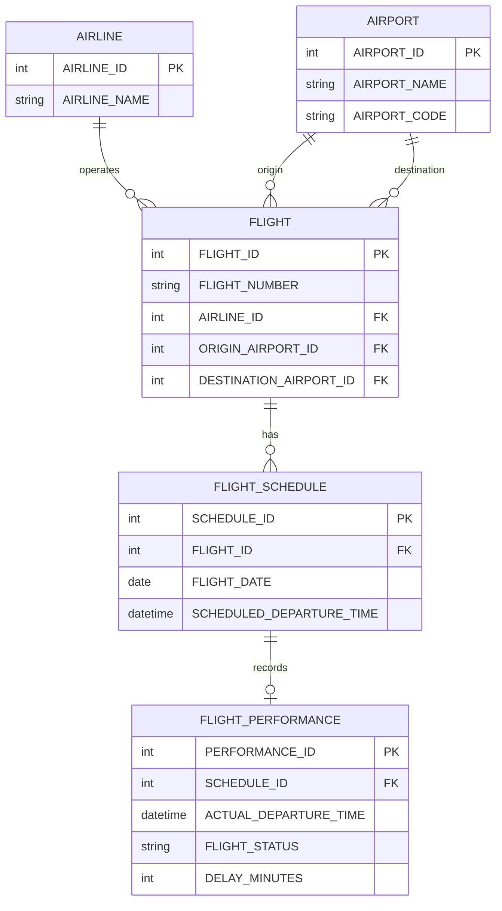

# Entity Relationship Diagram (ERD)

## Airline Flight Schedule and Delay Monitoring System

The ERD shows five entities and their relationships.

## Relationship Explanation

1. One airline can operate many flights.
2. One airport can be the origin of many flights.
3. One airport can be the destination of many flights.
4. One flight can have many schedules.
5. One schedule can have zero or one performance record.

**Note:** PK means Primary Key and FK means Foreign Key. The crow's-foot symbols show the relationships and cardinality between entities.
